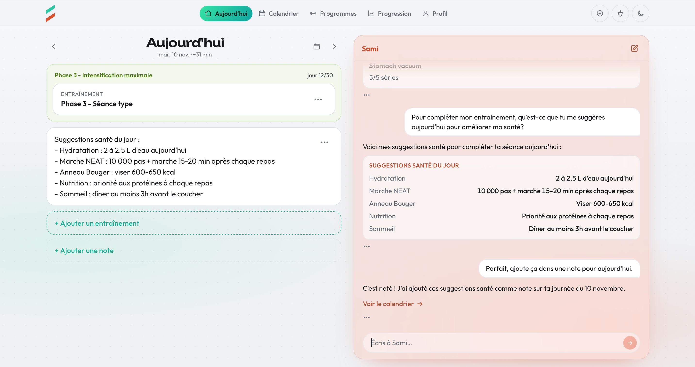
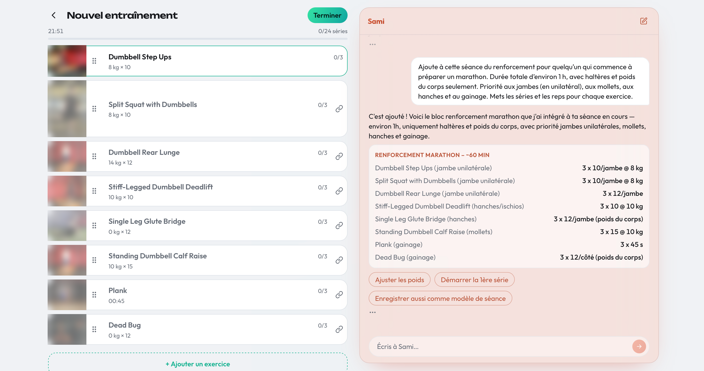
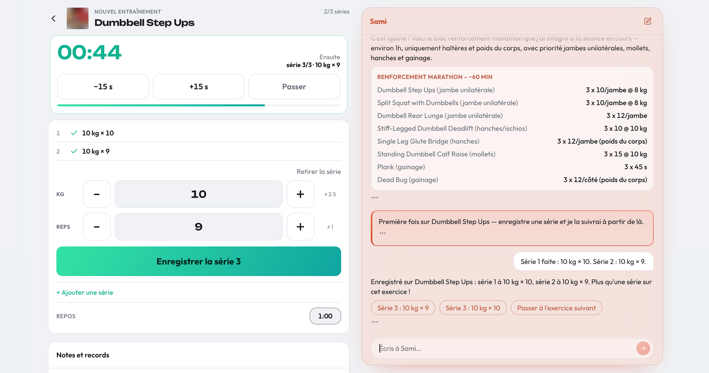
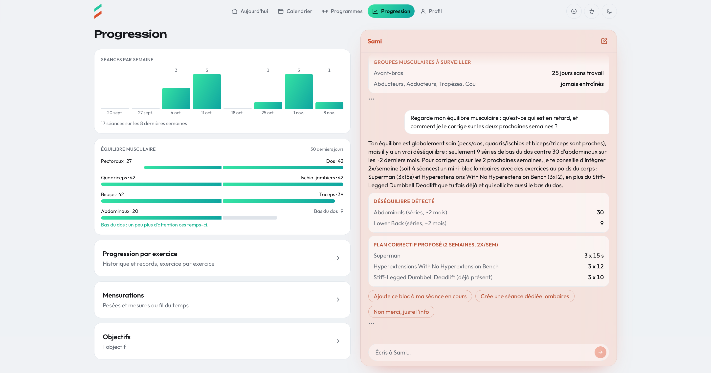
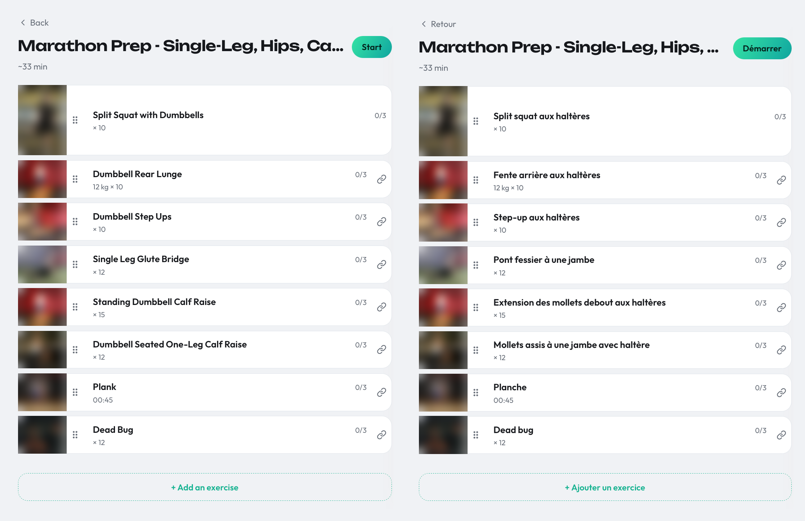

# Sami

[English](README.md) · Français

Une app bilingue (FR/EN) de suivi d'entraînement en salle avec un **coach IA résident**: le chat n'est pas une destination mais une surface présente sur chaque écran, capable de logger une série, de construire un workout ou de répondre à une question.

> **Statut :** bêta fermée, en développement actif. L'app web fonctionne; l'app iOS native n'est pas encore publiée.
> **Le code source est privé.** Je vous le présenterai volontiers en direct, voir [Walkthrough sur demande](#walkthrough-sur-demande).



*L'écran du jour avec le coach à côté. Je lui ai demandé des suggestions santé pour la journée, puis de les enregistrer en note sur la page d'aujourd'hui.*

## En 30 secondes

- **Ce que c'est :** une app d'entraînement en salle (web, API, iOS natif) avec un coach IA sur chaque écran, construite sur l'API Claude avec du tool use.
- **Pourquoi ça vaut le coup d'œil :** l'ingénierie autour du modèle. Une frontière stricte pour les tools, une identité que le modèle ne peut jamais définir, du prompt caching avec suivi des coûts, un transcript qui survit aux longues conversations, et des bugs trouvés en usage réel transformés en tests.
- **Comment c'est construit :** Claude Code écrit la majorité du code. Je prends les décisions, je fixe les règles dans lesquelles il travaille et je relis chaque changement.

Pressé? Lisez [La boucle décide selon le contenu](#la-boucle-décide-selon-le-contenu-pas-selon-stop_reason) pour un vrai incident, puis [Comment c'est construit](#comment-cest-construit) pour ma façon de travailler.

## Ce que c'est

Sami est une app web, une API et une app iOS native. On y logue des workouts et des séances, on suit des plans et des objectifs, et on suit sa progression. Sami, le coach IA, vit sur les mêmes écrans et fait les mêmes choses qu'on peut faire à la main, par la même couche de services, pas par une porte dérobée.

Elle est bilingue comme les gens qui s'entraînent l'utilisent vraiment: la langue de l'interface et celle des noms d'exercices sont deux réglages séparés, donc un utilisateur francophone peut garder « Bench Press » en anglais et tout le reste en français.

Le point intéressant n'est pas le domaine du fitness. C'est la façon dont un LLM est branché dans une vraie application sans devenir un problème de sécurité ou de coût.

## Captures d'écran

*Les photos de démonstration des exercices sont floutées dans ces captures.*



*Une seule demande, un workout complet: le coach ajoute à la séance en cours un bloc de renforcement pour la préparation marathon, et les huit exercices apparaissent dans l'éditeur à côté du chat.*



*Logger en parlant: j'ai donné au coach le poids et les reps de deux séries, et elles apparaissent comme faites sur l'écran de séance.*



*Progression: à ma question sur l'équilibre musculaire, le coach voit que le bas du dos est en retard sur les abdominaux et propose un plan correctif de deux semaines, avec des boutons pour l'ajouter à la séance en cours ou créer un workout dédié.*



*Le même workout en anglais (à gauche) et en français (à droite). La langue de l'interface et celle des noms d'exercices sont deux réglages séparés.*

## En un coup d'œil

- **541 commits et plus de 500 pull requests** (repo privé) en environ 14 semaines (de juillet à octobre 2026)
- **2 595 tests** (1 481 pour l'API, 1 114 pour le web), tous au vert au moment de l'écriture, plus 44 sur l'outillage du repo; l'app iOS a ses propres tests
- **9 tools IA**, chacun avec un schéma zod strict
- **35 tables, 25 migrations**
- **Une app SwiftUI native** (environ 350 fichiers Swift, répartis en trois modules)
- **314 entrées de log datées** documentant chaque travail livré

## Stack

- **Web :** React 19, Vite, TypeScript, UI bilingue
- **API :** Hono, Drizzle ORM, Postgres (Neon), zod, OpenAPI
- **iOS :** SwiftUI
- **IA :** API Claude avec tool use, streaming via SSE
- **Infra :** Vercel (deux projets: web et API)
- **Tests :** Vitest, avec un Postgres en processus (PGlite) derrière les tests de base de données de l'API

## Architecture

Les extraits de code ci-dessous sont simplifiés à partir du vrai code.

### Une seule couche de services, deux portes d'entrée

L'IA n'a pas son propre backend. Les écrans CRUD et le coach IA passent tous deux par la couche de services; les règles (vérification d'ownership, validation, codes d'erreur stables) y vivent au lieu d'être dupliquées pour l'IA. Les handlers de tools se trouvent derrière une seule frontière de dispatch et appellent les mêmes fonctions de service que les routes HTTP.

```ts
// The single seam between the AI loop and the rest of the API. The chat route
// partially applies it with the authenticated context (db, user, locale, units),
// so the loop never sees the service layer or who the user is.
export type ToolResult =
  | { ok: true; data: unknown }
  | { ok: false; code: string; message: string };

export type ExecuteTool = (tool: string, input: unknown) => Promise<ToolResult>;
```

### Des tools stricts, et une identité qui n'est jamais l'affaire du modèle

Chacun des 9 tools a un schéma zod pour son entrée et un handler dédié. L'identité de l'utilisateur et sa locale ne sont jamais des paramètres de tool: le serveur les fournit, et le modèle ne peut ni les passer ni les modifier. Un « agis comme un autre utilisateur » injecté dans un prompt n'a rien sur quoi agir.

```ts
// One tool, one discriminated union on `action`. strictObject rejects unknown
// keys, and there is no userId anywhere: identity is injected at dispatch.
export const manageBodyMeasurement = z.discriminatedUnion('action', [
  z.strictObject({
    action: z.literal('log'),
    type: measurementType,
    value: z.number(),
    unit: measurementUnit,
  }),
  z.strictObject({ action: z.literal('delete'), measurementId: id }),
  z.strictObject({
    action: z.literal('list'),
    type: measurementType.optional(),
    ...pageShape,
  }),
  z.strictObject({
    action: z.literal('getSeries'),
    type: measurementType,
    from: isoDate.optional(),
    to: isoDate.optional(),
  }),
]);
```

### Testé sans API réelle

La boucle de conversation tourne contre un client Anthropic scripté: pas de réseau, pas de clé API, déterministe. Elle couvre les bugs qui se sont réellement produits, comme l'appel de tool orphelin ci-dessous.

### La boucle décide selon le contenu, pas selon `stop_reason`

Tout bloc `tool_use` est traité, quel que soit le `stop_reason`. Cette règle vient d'une vraie panne: une réponse est arrivée avec `stop_reason: "end_turn"` tout en contenant un appel de tool. Se fier au stop reason a fait sauter l'appel, et le transcript sauvegardé se terminait sur un appel de tool sans résultat, que l'API a refusé à chaque tour suivant pour ce compte. La boucle regarde maintenant ce que le modèle a réellement produit.

```ts
// The content decides, never `stop_reason`.
const toolUses = res.content.filter(
  (b): b is Anthropic.ToolUseBlock => b.type === 'tool_use',
);
if (toolUses.length === 0) {
  return { response: { text: joinText(res.content) }, messages };
}
// Any tool_use block is processed below, whatever res.stop_reason says.
```

### Le transcript est géré, pas seulement complété

- **Pairing :** chaque appel de tool est apparié avec son résultat avant tout envoi.
- **Windowing :** la fenêtre coupe sur un message utilisateur, donc un échange n'est jamais coupé en deux.
- **Compaction :** les anciens résultats de tools sont remplacés par un marqueur, les paires d'appels restent intactes. Mesuré sur de vraies conversations avant qu'elle existe, les outputs de tools représentaient 58 % de ce que chaque tour ajoutait au thread, et le tour médian s'ouvrait déjà sur environ 100 000 tokens d'input.

Deux des trois sont écrits en pensant au prompt cache. Le pairing écrit des chaînes fixes, donc un transcript réparé reste les mêmes octets à chaque tour suivant. La fenêtre coupe par paquets (de 300 messages à 200) plutôt qu'un message à la fois, donc le préfixe en cache n'est réécrit qu'à chaque coupure et non à chaque tour. Dans un tour, le tableau avec lequel la boucle travaille est seulement complété, et la compaction s'applique uniquement au transcript renvoyé à la fin du tour, jamais à celui en cours.

### Prompt caching à deux niveaux, et un coût que l'on peut comptabiliser

- Chaque round-trip du modèle dans un tour demande le caching automatique, donc les suivants relisent ce que les précédents ont envoyé.
- Les définitions de tools sont identiques pour chaque utilisateur et chaque appel, elles ont donc leur propre cache breakpoint et sont réutilisées d'un tour à l'autre.
- L'input total d'un round-trip se compte ainsi: input non caché + lectures de cache + écritures de cache, chacun au tarif qui lui correspond, et l'enregistrement d'usage par tour additionne la même somme.

```ts
// The tool list is a constant, so its last entry carries a cache breakpoint.
const toolsWithCacheBreakpoint: Anthropic.Tool[] = [
  ...anthropicTools.slice(0, -1),
  { ...anthropicTools.at(-1)!, cache_control: { type: 'ephemeral' } },
];

const res = await client.messages.create({
  model,
  max_tokens,
  system, // built once, before the loop
  tools: toolsWithCacheBreakpoint,
  messages, // only ever appended to during a turn
  // Automatic caching: each round-trip reads what the previous one sent.
  cache_control: { type: 'ephemeral' },
});
```

### Une conversation sur plusieurs appareils

L'état du chat est sauvegardé avec un jeton de version. Une sauvegarde faite depuis une copie plus ancienne est refusée avec un 409 et le client reprend la copie du serveur, ce qui permet à une conversation de suivre l'utilisateur du téléphone au navigateur sans s'écraser en silence.

### L'humain reste l'auteur de tout ce dont le coach IA « se souvient »

Le modèle peut proposer des notes à garder, via un seul appel de tool forcé en dehors de la boucle principale. Aucun tool ne peut les écrire: l'utilisateur relit et décide.

### Des erreurs sur lesquelles le coach IA peut agir

Une erreur d'unicité brute de la base de données est traduite en une erreur récupérable que le coach IA peut lire, au lieu de laisser fuiter un message du driver vers le modèle. Les erreurs de service portent des codes stables, mappés vers un statut HTTP à un seul endroit.

### Contrôle des coûts

L'usage de l'IA est limité par utilisateur et appliqué côté serveur, à chaque requête.

### Une API typée

Les routes sont déclarées avec des schémas et exposées en spec OpenAPI, avec des tests qui vérifient la couverture, la nullabilité et la forme des erreurs afin que la spec ne s'écarte pas discrètement du code. Le stockage est métrique canonique, et la conversion d'unités se fait aux frontières HTTP et IA, jamais dans la couche de services.

## Comment c'est construit

Claude Code écrit la majorité du code. Je garde la direction, les règles dans lesquelles il travaille et la relecture.

- **Je décide, Claude propose.** Les choix de design arrivent sous forme d'options avec compromis et une recommandation, et le résultat est consigné avec un statut: `PROPOSED`, `DECIDED`, `SHIPPED`, `DEFERRED`, `REJECTED` ou `SUPERSEDED`. Seul `SHIPPED` porte un pointeur vers le code, ce qui évite de lire un plan comme la description de ce qui est construit. Les idées rejetées ou reportées restent visibles exprès. Par exemple, en travaillant sur autre chose, l'agent a remarqué qu'un utilisateur impérial pouvait saisir des livres dans un champ qui stockait des kilogrammes. Il n'a pas choisi de correctif seul: il a consigné l'écart et m'a laissé le choix, puis la règle a été réécrite pour convertir à la frontière HTTP, là où la couche IA le faisait déjà.
- **Je fixe les règles.** Un fichier d'instructions du projet encode les non-négociables: l'agent ne merge jamais, n'écrit jamais dans la base de production sans mon accord pour cette opération précise, l'identité n'est jamais un paramètre de tool, et aucune abstraction n'est ajoutée sans un second appelant démontré. Quand une règle se révèle fausse, elle est corrigée et la correction est datée.
- **Les machines vérifient d'abord.** `/change` démarre chaque branche depuis un `master` à jour. `/submit` lance le lint, les tests, le build, vérifie les conventions de documentation et le formatage, et lance des reviewers à contexte froid (des agents neufs qui vérifient les changements de schéma contre le doc du modèle de données et les changements d'UI contre les docs de design, pour que leur lecture ne soit pas biaisée par la session qui a écrit le code). Il s'arrête au premier échec, puis rebase et ouvre la pull request.
- **Ensuite je relis le diff et je merge.** C'est un projet solo, il n'y a donc volontairement pas de CI côté serveur; ce serait un petit pas à ajouter si le projet grandit.
- **Je mesure avant d'optimiser.** La fenêtre de compaction (les cinq derniers tours gardent leurs résultats de tools) correspond au 90e percentile des rafales de vraies conversations, et les passes de reviewers sont limitées à une par tâche après avoir mesuré ce qu'elles coûtent.
- **Tout ce qui est livré est écrit.** Une entrée de log datée par travail, avec le raisonnement qui serait sinon perdu.

## Limites et prochaines étapes

Ce que ce projet n'est pas, pour l'instant:

- **Pas de CI côté serveur.** Les contrôles qualité tournent sur ma machine avant chaque pull request. À ajouter si le projet grandit: les mêmes vérifications sur chaque pull request.
- **Pas d'evals.** Les tests couvrent la logique de la boucle avec un client scripté, mais rien ne mesure encore la qualité réelle des réponses du coach. Ensuite: des conversations de référence qui notent les appels de tools.
- **Le prompt injection est traité par l'architecture, pas par des tests.** L'identité et l'ownership sont appliqués hors du modèle, donc un texte injecté ne peut pas atteindre le compte d'un autre, mais je n'ai pas construit de suite de tests adversariale. Ensuite: en ajouter une, y compris l'injection via des données stockées comme une note ou un nom d'exercice.
- **Petite échelle.** C'est une bêta fermée gérée par une seule personne, donc je n'ai pas de données sur le comportement sous forte charge.

## Walkthrough sur demande

Le code reste privé: le produit évolue encore et est en bêta fermée. Si vous êtes curieux, je me ferai un plaisir de vous présenter le code et de vous montrer la boucle de tools, les tests, la configuration du prompt caching ou le workflow Claude Code.

- **LinkedIn :** [linkedin.com/in/remyparent](https://www.linkedin.com/in/remyparent)
- **Portfolio :** [cv.remyparent.com](https://cv.remyparent.com)
- **Code public :** [xyphoide/cv](https://github.com/xyphoide/cv), la source de mon site CV, avec CI et tests de bout en bout

— Rémy Parent, développeur full-stack senior
