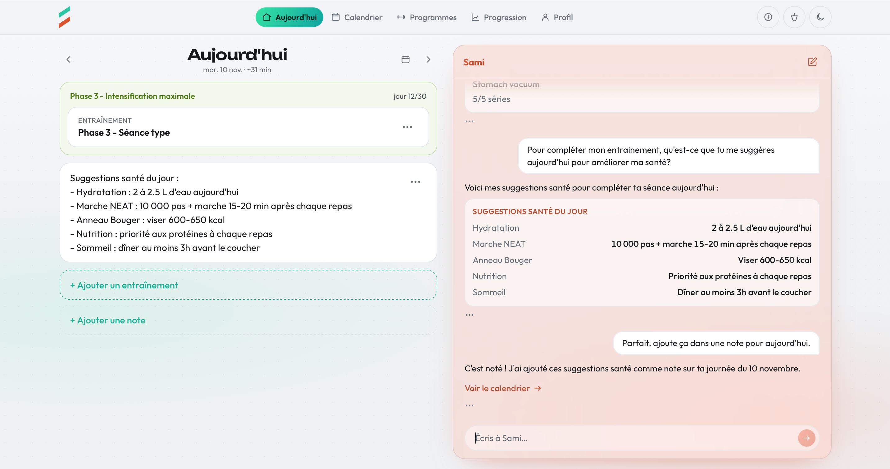
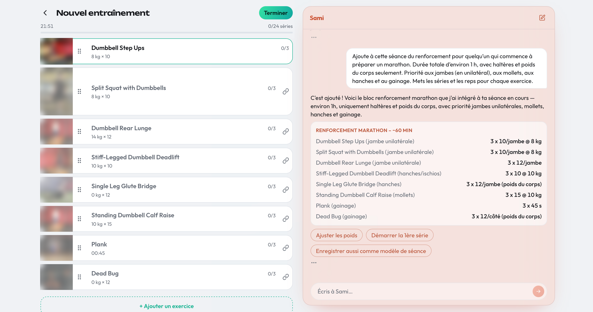
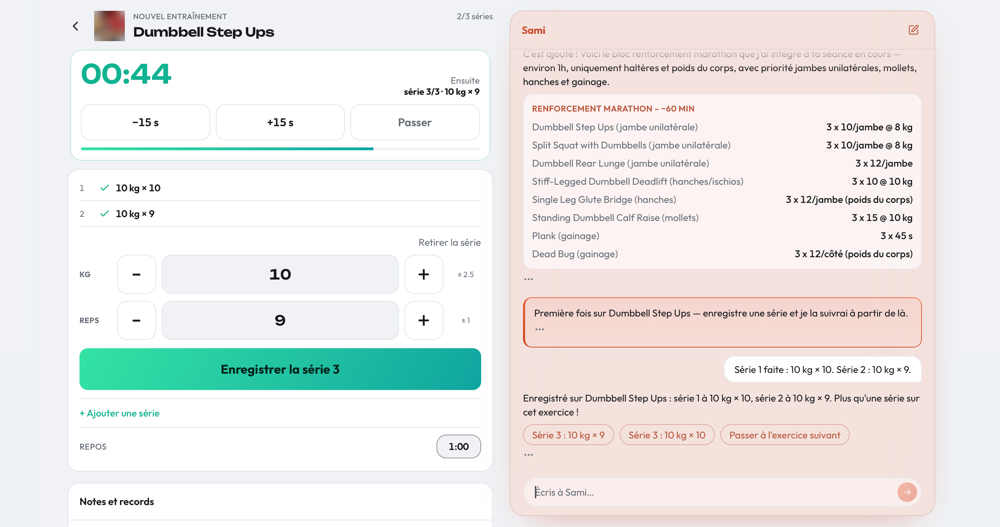
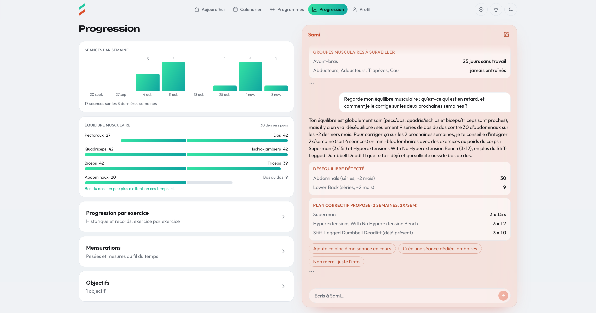
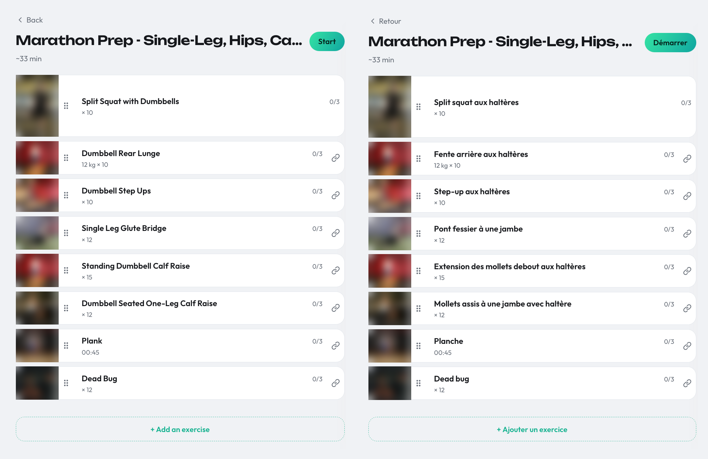

# Sami

English · [Français](README.fr.md)

A bilingual (FR/EN) strength-training app with a **resident AI coach**: the chat is not a destination but a surface present on every screen, able to log a set, build a workout or answer a question.

> **Status:** closed beta, in active development. The web app is running; the native iOS app is not released yet.
> **Source code is private.** I'm happy to walk you through it live, see [Walkthrough on request](#walkthrough-on-request).



*The Today screen with the coach beside it. I asked for health suggestions for the day, then told it to save them as a note on today's page.*

## In 30 seconds

- **What it is:** a strength-training app (web, API, native iOS) with an AI coach on every screen, built on the Claude API with tool use.
- **Why it's worth a look:** the engineering around the model. A strict tool boundary, identity that the model can never set, prompt caching with cost accounting, a transcript that survives long conversations, and bugs found in real use turned into tests.
- **How it's built:** Claude Code writes most of the code. I make the decisions, set the rules it works under, and review every change.

Short on time? Read [The loop decides by content](#the-loop-decides-by-content-not-by-stop_reason) for a real incident, then [How it's built](#how-its-built) for my workflow.

## What it is

Sami is a web app, an API and a native iOS app. You log workouts and sessions, follow plans and goals, and track progress. Sami, the AI coach, lives on the same screens and does the same things you can do by hand, through the same service layer, not through a side door.

It is bilingual the way lifters actually use it: the interface language and the exercise-name language are two separate settings, so a French-speaking user can keep "Bench Press" in English and everything else in French.

The interesting part is not the fitness domain. It's how an LLM is plugged into a real application without becoming a security or cost problem.

## Screenshots

*The captures show the French interface; the last one shows both languages. Exercise demonstration photos are blurred.*



*One request, a whole workout: the coach adds a marathon-prep strength block to the session in progress, and the eight exercises appear in the editor next to the chat.*



*Logging by talking: I gave the coach the weight and reps for two sets, and they show up as done on the session screen.*



*Progress: asked about my muscle balance, the coach sees lower-back work lagging behind abdominals and proposes a two-week corrective plan, with buttons to add it to the current session or create a dedicated workout.*



*The same workout in English (left) and French (right). The interface language and the exercise-name language are two separate settings.*

## At a glance

- **541 commits and 500+ pull requests** (private repository) in about 14 weeks (July to October 2026)
- **2,595 tests** (1,481 in the API, 1,114 in the web app), all passing at the time of writing, plus 44 on the repo's tooling; the iOS app has its own tests
- **9 AI tools**, each with a strict zod schema
- **35 database tables, 25 migrations**
- **A native SwiftUI app** (about 350 Swift files, split into three modules)
- **314 dated log entries** documenting every piece of shipped work

## Stack

- **Web:** React 19, Vite, TypeScript, bilingual UI
- **API:** Hono, Drizzle ORM, Postgres (Neon), zod, OpenAPI
- **iOS:** SwiftUI
- **AI:** Claude API with tool use, streaming over SSE
- **Infra:** Vercel (two projects: web and API)
- **Tests:** Vitest, with an in-process Postgres (PGlite) behind the API's database tests

## Architecture

Code excerpts below are simplified from the real code.

### One service layer, two front doors

The AI does not have its own backend. The CRUD screens and the AI coach both go through the service layer, so the rules (ownership checks, validation, stable error codes) live there rather than being duplicated for the AI. The tool handlers sit behind a single dispatch boundary and call into the same service functions the HTTP routes use.

```ts
// The single seam between the AI loop and the rest of the API. The chat route
// partially applies it with the authenticated context (db, user, locale, units),
// so the loop never sees the service layer or who the user is.
export type ToolResult =
  | { ok: true; data: unknown }
  | { ok: false; code: string; message: string };

export type ExecuteTool = (tool: string, input: unknown) => Promise<ToolResult>;
```

### Tools are strict and identity is never the model's business

Each of the 9 tools has a zod schema for its input and a dedicated handler. The user's identity and locale are never tool parameters: the server supplies them, and the model can't pass or override them. A prompt-injected "act as another user" has nothing to act on.

```ts
// One tool, one discriminated union on `action`. strictObject rejects unknown
// keys, and there is no userId anywhere: identity is injected at dispatch.
export const manageBodyMeasurement = z.discriminatedUnion('action', [
  z.strictObject({
    action: z.literal('log'),
    type: measurementType,
    value: z.number(),
    unit: measurementUnit,
  }),
  z.strictObject({ action: z.literal('delete'), measurementId: id }),
  z.strictObject({
    action: z.literal('list'),
    type: measurementType.optional(),
    ...pageShape,
  }),
  z.strictObject({
    action: z.literal('getSeries'),
    type: measurementType,
    from: isoDate.optional(),
    to: isoDate.optional(),
  }),
]);
```

### Tested without a live API

The conversation loop runs against a scripted Anthropic client: no network, no API key, deterministic. It covers the bugs that actually happened, like the orphaned tool call below.

### The loop decides by content, not by `stop_reason`

Any `tool_use` block is processed, whatever the `stop_reason` says. This came from a real failure: one response arrived with `stop_reason: "end_turn"` yet contained a tool call. Trusting the stop reason skipped the call, and the saved transcript ended on a tool call with no result, which the API refused on every later turn for that account. The loop now looks at what the model actually produced.

```ts
// The content decides, never `stop_reason`.
const toolUses = res.content.filter(
  (b): b is Anthropic.ToolUseBlock => b.type === 'tool_use',
);
if (toolUses.length === 0) {
  return { response: { text: joinText(res.content) }, messages };
}
// Any tool_use block is processed below, whatever res.stop_reason says.
```

### The transcript is managed, not just appended

- **Pairing:** every tool call is paired with its result before anything is sent.
- **Windowing:** the window cuts at a user message, so an exchange is never split in half.
- **Compaction:** old tool results are replaced by a marker while the call pairs stay intact. Measured on real conversations before it existed, tool output made up 58% of what each turn added to the thread, and the median turn already opened on about 100,000 input tokens.

Two of the three are written with the prompt cache in mind. Pairing writes fixed strings, so a repaired transcript is the same bytes on every later turn. The window cuts in batches (from 300 messages down to 200) rather than one message at a time, so the cached prefix is rewritten once per cut instead of on every turn. Within a turn, the array the loop works on is only ever appended to, and compaction is applied only to the transcript handed back at the end of the turn, never to the one in flight.

### Prompt caching at two levels, and cost you can account for

- Each model round-trip inside a turn asks for automatic caching, so later round-trips read what earlier ones sent.
- The tool definitions are identical for every user and every call, so they get their own cache breakpoint and are reused across turns.
- A round-trip's total input is counted as uncached input plus cache reads plus cache writes, each priced at its own rate, and the per-turn usage record adds up the same sum.

```ts
// The tool list is a constant, so its last entry carries a cache breakpoint.
const toolsWithCacheBreakpoint: Anthropic.Tool[] = [
  ...anthropicTools.slice(0, -1),
  { ...anthropicTools.at(-1)!, cache_control: { type: 'ephemeral' } },
];

const res = await client.messages.create({
  model,
  max_tokens,
  system, // built once, before the loop
  tools: toolsWithCacheBreakpoint,
  messages, // only ever appended to during a turn
  // Automatic caching: each round-trip reads what the previous one sent.
  cache_control: { type: 'ephemeral' },
});
```

### One conversation across devices

The chat state is saved with a version token. A save made from an older copy is refused with a 409 and the client takes the server's copy, which is what lets a conversation follow the user from the phone to the browser without silently overwriting itself.

### The human stays the writer for anything the AI coach "remembers"

The model can propose notes worth keeping, through one forced tool call outside the main loop. No tool can write them: the user reviews and decides.

### Errors the AI coach can act on

A raw database uniqueness error is translated into a recoverable error the AI coach can read, instead of leaking a driver message to the model. Service errors carry stable codes, mapped to HTTP status in a single place.

### Cost control

AI usage is limited per user and enforced on the server, for every request.

### A typed API

Routes are declared with schemas and exposed as an OpenAPI spec, with tests that check coverage, nullability and error shapes so that the spec can't quietly drift from the code. Storage is canonical metric, and unit conversion happens at the HTTP and AI boundaries, never inside the service layer.

## How it's built

Claude Code writes most of the code. I own the direction, the rules it works under, and the review.

- **I decide, Claude proposes.** Design choices come as options with trade-offs and a recommendation, and the outcome is logged with a status: `PROPOSED`, `DECIDED`, `SHIPPED`, `DEFERRED`, `REJECTED` or `SUPERSEDED`. Only `SHIPPED` carries a pointer to the code, which stops a plan from being read as a description of what's built. Rejected and deferred ideas stay visible on purpose. For example, while building something unrelated, the agent noticed that an imperial user could type pounds into a field that stored kilograms. It didn't pick a fix on its own: it logged the gap and left the choice to me, and the rule was then rewritten to convert at the HTTP boundary, where the AI layer already did.
- **I set the rules.** A project instruction file encodes the non-negotiables: the agent never merges, never writes to the production database without my approval for that specific operation, identity is never a tool parameter, and no abstraction is added without a demonstrated second caller. When a rule proves wrong, it is corrected and the correction is dated.
- **Machines check first.** `/change` starts every branch from an up-to-date `master`. `/submit` lints, tests, builds, checks documentation conventions and formatting, and runs cold-context reviewers (fresh agents that check schema changes against the data-model doc and UI changes against the design docs, so their read isn't biased by the session that wrote the code). It stops at the first failure, then rebases and opens the pull request.
- **Then I read the diff and merge.** It's a solo project, so there is deliberately no server-side CI; it would be a small step to add if the project grows.
- **I measure before optimizing.** The compaction window (the last five turns keep their tool output) is the 90th percentile of bursts in real conversations, and reviewer passes are capped at one per task after measuring what they cost.
- **Everything shipped is written down.** One dated log entry per piece of work, with the reasoning that would otherwise be lost.

## Limits and next steps

What this project is not, yet:

- **No server-side CI.** Quality gates run on my machine before each pull request. Worth adding if the project grows: the same checks on every pull request.
- **No evals.** The tests cover the loop's logic with a scripted client, but nothing yet measures how well the coach actually answers. Next: golden conversations that score the tool calls.
- **Prompt injection is handled by architecture, not by tests.** Identity and ownership are enforced outside the model, so injected text can't reach another account, but I haven't built an adversarial test suite. Next: one, including injection through stored data such as a note or an exercise name.
- **Small scale.** It's a closed beta run by one person, so I have no data on how it behaves under heavy load.

## Walkthrough on request

The code stays private: the product is still evolving and in a closed beta. If you're curious, I'm happy to walk you through the code and show you the tool loop, the tests, the prompt-caching setup or the Claude Code workflow.

- **LinkedIn:** [linkedin.com/in/remyparent](https://www.linkedin.com/in/remyparent)
- **Portfolio:** [cv.remyparent.com](https://cv.remyparent.com)
- **Public code:** [xyphoide/cv](https://github.com/xyphoide/cv), the source of my CV site, with CI and end-to-end tests

— Rémy Parent, senior full-stack developer
